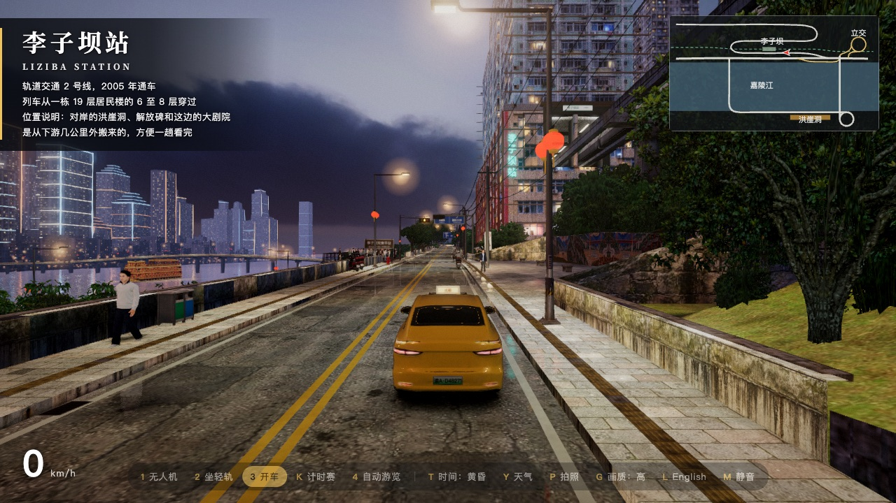
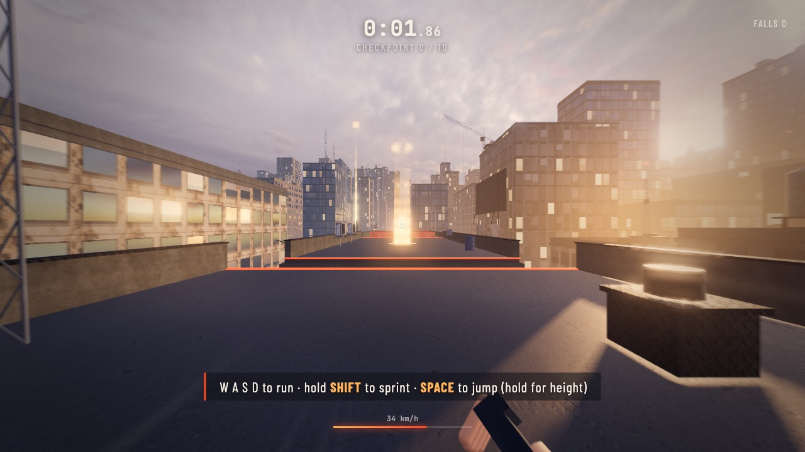
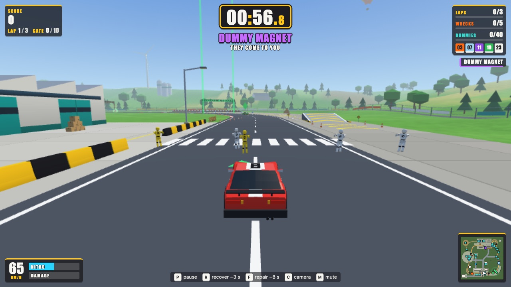

# Awesome HTML Games · Fable 5.2 小游戏收藏

这是一批由 **Fable 5.2**（AI 辅助编程）在很短时间内生成的网页小游戏合集，题材涵盖开放世界、FPS、RTS、解谜、驾驶、体育、恐怖、仙侠等。技术栈以 Three.js / WebGL、Canvas 2D 与原生 JS 为主，不少作品被压缩成单个 HTML 文件。本仓库将可离线运行的版本归档到 [`games/`](games/)，封面图存于 [`screenshots/`](screenshots/)，并在每条下方注明原始来源与作者。

**仓库地址**：[GuoCoder/awesome-html-games](https://github.com/GuoCoder/awesome-html-games)

**收录**：116 款（本地离线归档 22 款，其余为在线演示或源码链接） · 数据快照：2026-11-22

## 离线运行说明

- `games/<编号>/` 为对应游戏的离线归档目录，入口为 `index.html`。

### 推荐方式：本地静态服务器（全部作品通用）

- 双击 `index.html` 以 `file://` 打开时，部分作品会被浏览器安全策略拦截。建议统一在仓库根目录起一个静态服务器：

  ```bash
  cd D:\html
  python -m http.server 8123
  # 浏览器打开 http://localhost:8123/games/<编号>/
  ```

- 或进入单个作品目录再起服务：

  ```bash
  cd games/17
  python -m http.server 8000
  # 浏览器打开 http://localhost:8000
  ```

### 为什么双击打不开（`file://` 限制）

- 以 `file://` 打开时，页面来源（origin）为 `null`，浏览器会拦截两类操作：
  1. **ES Module 脚本**（`<script type="module">`）：本地模块文件被 CORS 策略阻止加载；
  2. **运行时 `fetch` 本地文件**：`data/*.bin`、`assets/*.json`、模型/贴图/音频等本地资源同样被跨域拦截。
- 被拦截时控制台通常报 `origin 'null' ... blocked by CORS policy`，页面只剩空白画布；走 `http://localhost` 属同源请求，限制不再生效。

### 哪些必须用服务器、哪些可双击

- **必须通过本地服务器打开**：使用 ES Module，或运行时加载本地数据/模型的作品，如 02、10、16、17、19、23、26、29；双击会被浏览器拦截。
- **一般可直接双击**：纯内联单文件、经典 `<script>`、运行时不拉取本地资源的作品（如 00、06、07、20、22、25、28、45）；若个别浏览器仍拦截，改用服务器即可。

### 其他离线限制

- 多人联机（Node/WebSocket）、需摄像头或在线 AI 识别的作品无法完全离线，README 中已单独标注。
- 部分素材在作者源站已失效（404），归档时一并记录，不影响页面与主体结构留存。

## 游戏列表

### 00 · 几猫3A大作（几猫CS）


**中文**：Saltline 的全中文本地化重混：把雨夜集装箱港口 FPS 改头换面成了「几猫」货运站，玩法与氛围一脉相承，文案与美术全部中文化。

**EN**: A fully Chinese-localized remix of Saltline: a rain-soaked container-port FPS rebranded as the 几猫 shipping terminal.

<sub>类别：FPS · 语言：HTML · 全中文重混</sub>

[离线归档](games/00/) ｜ [在线试玩](https://fable52.games/play/jimao-cs)


### 01 · FOG CITY

**中文**：一款 three.js 开放世界探索项目，采用多文件 ES Module 组织、无构建步骤；目前未公开在线演示，仅能从源码仓库查看。

<sub>类别：开放世界 · 技术：three.js · 语言：JavaScript</sub>

[源码](https://github.com/Rikinshah787/Game-Fable-5.2)

*感谢作者 **@Rikinshah787** 的开源分享！*

### 02 · Dustfall


**中文**：原创西部开放世界：骑马驰骋、狩猎、钓鱼、打牌，在索雷尔盆地（Sorrel Basin）了结一段旧怨。

**EN**: An original open-world western: ride, hunt, fish, play cards and settle an old score in the Sorrel Basin.

<sub>类别：开放世界 · 技术：three.js 0.187 + Vite 8 · 语言：JavaScript · 体量：1.4 MB · 游玩量：443</sub>

[离线归档](games/02/) ｜ [在线试玩](https://fable52.games/play/dustfall) ｜ [作者演示站](https://dustfalls.netlify.app/) ｜ [源码](https://github.com/webKing021/dustfall)

*感谢作者 **@webKing021** 的开源分享！*

### 03 · Bayhaven


**中文**：一款开放世界犯罪题材游戏，由 Fable 5.2 在一次次自主会话中实时编写而成，偏展示与叙事向。

**EN**: An original open-world crime game written live by Fable 5.2, one autonomous session at a time.

<sub>类别：开放世界 · 技术：three.js · 语言：JavaScript · 体量：1.4 MB · 游玩量：482</sub>

[离线归档](games/03/) ｜ [在线试玩](https://fable52.games/play/bayhaven) ｜ [作者演示站](https://fablestar.games/watch.html) ｜ [源码](https://github.com/fablestar/bayhaven)

*感谢作者 **@fablestar** 的开源分享！*

### 04 · Aquila

**中文**：three.js + esbuild 打包的单文件 HTML 开放世界小游戏，与 05 同属一个随机生成仓库，暂未提供在线演示。

<sub>类别：开放世界 · 技术：three.js · 语言：HTML</sub>

[源码](https://github.com/GavinLOrio/Fable-5.2-random-game)

*感谢作者 **@GavinLOrio** 的开源分享！*

### 05 · Dawnward

**中文**：与 04 同仓库的另一款 esbuild 单文件 HTML 开放世界作品，暂未提供在线演示，仅见源码。

<sub>类别：开放世界 · 技术：three.js · 语言：HTML</sub>

[源码](https://github.com/GavinLOrio/Fable-5.2-random-game)

*感谢作者 **@GavinLOrio** 的开源分享！*

### 06 · Ironvale


**中文**：3D 即时战略：采集资源、扩建基地、跨越三个时代，最终击败「绯红进军」（Crimson March）。

**EN**: A 3D real-time strategy game: gather, build, advance through three ages and defeat the Crimson March.

<sub>类别：RTS · 技术：three.js r128 · 语言：HTML · 体量：1.4 MB · 游玩量：353</sub>

[离线归档](games/06/) ｜ [在线试玩](https://fable52.games/play/ironvale) ｜ [作者演示站](https://sharpwizard.github.io/ironvale/) ｜ [源码](https://github.com/SharpWizard/ironvale)

*感谢作者 **@SharpWizard** 的开源分享！*

### 07 · Saltline


**中文**：初代「一句话提示」FPS：在雨夜笼罩的集装箱港口切断三个上行中继，同时躲避无人机与机器狗的猎杀，是掀起这波单提示 FPS 风潮的作品。

**EN**: The original one-prompt FPS: cut three uplink relays in a rainy container port while drones and robot dogs hunt you.

<sub>类别：FPS · 技术：three.js · 语言：HTML · 体量：1390KB · 游玩量：4.4k</sub>

[离线归档](games/07/) ｜ [在线试玩](https://fable52.games/play/saltline-fable-5-2-fps) ｜ [作者演示站](https://realcodebear.github.io/saltline-fable-5.2/) ｜ [源码](https://github.com/realcodebear/saltline-fable-5.2)

*感谢作者 **@realcodebear** 的开源分享！*

### 08 · 盐线行动 Online


**中文**：Saltline 的多人版：免费混战的港口枪战，5 秒快速复活；基于 Node 服务与 WebSocket，需联网对战，无法静态归档。

**EN**: Saltline goes multiplayer: a free-for-all online port shootout with 5-second respawns.

<sub>类别：FPS · 技术：three.js + WebSocket · 语言：JavaScript · 体量：1.4 MB · 游玩量：69</sub>

[在线试玩](https://fable52.games/play/saltline-online) ｜ [源码](https://github.com/wenzhengshi/fable5-2-salt-online)

*感谢作者 **@wenzhengshi** 的开源分享！*

### 09 · SUBLEVEL 07


**中文**：一句话 FPS 提示、73 轮自主迭代、41 分钟成品：湿润反光的地面与三波悬浮无人机，全部压进一个 128KB 文件。

**EN**: A one-sentence FPS prompt, 73 autonomous turns, 41 minutes: wet reflective floors and three waves of hover drones in a 128 KB file.

<sub>类别：FPS · 技术：three.js · 语言：HTML · 体量：128 KB · 游玩量：331</sub>

[离线归档](games/09/) ｜ [在线试玩](https://fable52.games/play/sublevel-07-fps-repro) ｜ [作者演示站](https://wquguru.github.io/fable52-fps-repro/) ｜ [源码](https://github.com/wquguru/fable52-fps-repro)

*感谢作者 **@wquguru** 的开源分享！*

### 10 · BLAMELESS


**中文**：值班运维题材射击：凌晨 3:07 生产挂了，你得亲自 kubectl exec 钻进生产环境排障。

**EN**: An on-call shooter: 03:07, prod is down, and you kubectl exec into production in person.

<sub>类别：FPS · 技术：three.js · 语言：JavaScript · 体量：1.4 MB · 游玩量：418</sub>

[离线归档](games/10/) ｜ [在线试玩](https://fable52.games/play/blameless) ｜ [作者演示站](https://blameless.petruha.ge/) ｜ [源码](https://github.com/Petyok/blameless)

*感谢作者 **@Petyok** 的开源分享！*

### 11 · Dustline Outpost

**中文**：three.js r128 制作，由 HTML、game.js 与资源目录组成；暂未提供在线演示，仅见源码仓库。

<sub>类别：FPS · 技术：three.js r128 · 语言：JavaScript</sub>

[源码](https://github.com/systemsluke/fable5.2game)

*感谢作者 **@systemsluke** 的开源分享！*

### 12 · Tidebell 潮钟


**中文**：驾驶一艘微型潜水器，从阳光明媚的礁潜向幽深海底，唤醒七口沉睡的潮钟。

**EN**: Pilot a tiny submersible from sunlit reefs to the abyss and wake seven sleeping tide bells.

<sub>类别：探索 · 技术：three.js r170 · 语言：HTML · 体量：3110KB · 游玩量：307</sub>

[在线试玩](https://fable52.games/play/tidebell) ｜ [源码](https://github.com/hahaliu1029/fable5.2demo)

*感谢作者 **@hahaliu1029** 的开源分享！*

### 13 · MOTHLIGHT // Vesper-9


**中文**：在雨夜湿滑的赛博朋克城市街头竞速，穿越五个街区、闯过 12 道光门。

**EN**: Street racing through a rain-slick cyberpunk city: thread 12 light gates across five districts.

<sub>类别：驾驶 · 技术：three.js r170 · 语言：HTML · 体量：1144KB · 游玩量：594</sub>

[在线试玩](https://fable52.games/play/mothlight) ｜ [源码](https://github.com/hahaliu1029/fable5.2demo)

*感谢作者 **@hahaliu1029** 的开源分享！*

### 14 · 青云宗 · 御剑采灵


**中文**：第三人称御剑穿行于云海之上：收集 20 缕灵气，点亮山门，再御剑穿门而出。

**EN**: Third-person sword flight over a sea of clouds: gather 20 motes of qi, light the sect gate and fly through.

<sub>类别：仙侠 · 技术：three.js r170 · 语言：HTML · 体量：2248KB · 游玩量：383</sub>

[在线试玩](https://fable52.games/play/qingyun-sword-flight) ｜ [源码](https://github.com/hahaliu1029/fable5.2demo)

*感谢作者 **@hahaliu1029** 的开源分享！*

### 15 · MISREMEMBER


**中文**：某种东西依照你的记忆重建了童年故居，而只要你注视着，周遭就什么都不会改变——一款心理向恐怖小品。

**EN**: Something rebuilt your childhood home from your memory of it, and nothing changes while you're looking.

<sub>类别：恐怖 · 技术：three.js · 语言：HTML · 体量：11020KB · 游玩量：86</sub>

[在线试玩](https://fable52.games/play/misremember) ｜ [源码](https://github.com/hahaliu1029/fable5.2demo)

*感谢作者 **@hahaliu1029** 的开源分享！*

### 16 · Hanford Reach


**中文**：漫步哥伦比亚河畔一座小镇的废墟，是一款温馨聚落建造游戏送出的首个可玩关卡。

**EN**: Walk the ruins of a small river town on the Columbia: the first playable stage of a cozy settlement builder made as a gift.

<sub>类别：建造 · 技术：three.js + Vite · 语言：JavaScript · 体量：1.4 MB · 游玩量：110</sub>

[离线归档](games/16/) ｜ [在线试玩](https://fable52.games/play/hanford-reach) ｜ [作者演示站](https://settlement-bluff-fable52.vercel.app/) ｜ [源码](https://github.com/chzbloom123/settlement-bluff-fable5.2)

*感谢作者 **@chzbloom123** 的开源分享！*

### 17 · Boring Game


**中文**：基于真实地图数据的体素旧金山湾区：规划线路、挑选盾构机，再一层层打通审批流程。

**EN**: A voxel San Francisco Bay Area on real map data: plan the line, pick the boring machine, cut the red tape.

<sub>类别：建造 · 技术：three.js + Vite · 语言：TypeScript · 体量：1.4 MB · 游玩量：74</sub>

[离线归档](games/17/) ｜ [在线试玩](https://fable52.games/play/boring-game-sf-bay-transit) ｜ [作者演示站](https://jakozaur.github.io/sf_bay_area_transit_fable_5_2_game/) ｜ [源码](https://github.com/jakozaur/sf_bay_area_transit_fable_5_2_game)

*感谢作者 **@jakozaur** 的开源分享！*

### 18 · Soccer 3D


**中文**：七人制 3D 足球，配备裁判、越位、卡牌、点球与战术系统，全部装在一个 HTML 文件里。

**EN**: Seven-a-side 3D football with referees, offside, cards, penalties and tactics, in one HTML file.

<sub>类别：体育 · 技术：自绘 3D · 语言：HTML · 体量：1243KB · 游玩量：1.1k</sub>

[离线归档](games/18/) ｜ [在线试玩](https://fable52.games/play/pocket-soccer-3d) ｜ [作者演示站](https://shaunprice.github.io/soccer-3d/) ｜ [源码](https://github.com/ShaunPrice/soccer-3d)

*感谢作者 **@ShaunPrice** 的开源分享！*

### 19 · TukTuk


**中文**：驾驶突突车穿行拥挤的街头，闪躲小巴、出租车和满载西瓜的货车。原作界面为阿拉伯语，本离线归档已整体汉化为中文；图形与音效均由代码实时生成，无外部素材依赖。

**EN**: Weave a tuk-tuk through a crowded Egyptian street, dodging microbuses, taxis and watermelon pickups.

<sub>类别：驾驶 · 技术：three.js · 语言：JavaScript · 体量：40 KB · 游玩量：189</sub>

[离线归档](games/19/) ｜ [在线试玩](https://fable52.games/play/tuktuk) ｜ [作者演示站](https://basemazab.github.io/tuktuk/) ｜ [源码](https://github.com/basemazab/tuktuk)

*感谢作者 **@basemazab** 的开源分享！*

### 20 · Emberdeep


**中文**：第一人称地牢下行，而你的火炬正在燃尽：找到三块碎片、打破封印，继续往深处走，支持单人或结伴。

**EN**: A first-person dungeon descent where your torch is burning down: find three shards, break the seal, go deeper. Solo or with friends.

<sub>类别：冒险 · 技术：原生 · 语言：HTML · 体量：100KB · 游玩量：80</sub>

[离线归档](games/20/) ｜ [在线试玩](https://fable52.games/play/emberdeep) ｜ [作者演示站](https://dndnoob.github.io/EmberDeep/) ｜ [源码](https://github.com/DNDNoob/EmberDeep)

*感谢作者 **@DNDNoob** 的开源分享！*

### 21 · Daedalus


**中文**：从海底一路攀登到奥林匹斯，穿越 30 台古代机械构成的谜题，途中与六位神祇相遇。

**EN**: Climb from the sea floor to Olympus through 30 puzzles built on ancient machines, and meet six gods on the way.

<sub>类别：解谜 · 技术：原生 · 语言：HTML · 体量：121KB · 游玩量：105</sub>

[离线归档](games/21/) ｜ [在线试玩](https://fable52.games/play/daedalus) ｜ [作者演示站](https://s77ffy.github.io/daedalus/) ｜ [源码](https://github.com/S77FFY/daedalus)

*感谢作者 **@S77FFY** 的开源分享！*

### 22 · Sternenjäger


**中文**：科幻太空射击：12 个星域、3 场 Boss 战，全部封装在一个 HTML 文件里。

**EN**: A sci-fi space shooter with 12 sectors and 3 boss fights, all in one HTML file.

<sub>类别：射击 · 技术：原生 · 语言：HTML · 体量：40KB · 游玩量：90</sub>

[离线归档](games/22/) ｜ [在线试玩](https://fable52.games/play/sternenjaeger) ｜ [作者演示站](https://oldzitterhand.github.io/sternenjaeger/) ｜ [源码](https://github.com/oldzitterhand/sternenjaeger)

*感谢作者 **@oldzitterhand** 的开源分享！*

### 23 · Shuttle Strike


**中文**：第一人称羽毛球：调用摄像头追踪手部，完成握拍、挥拍与扣杀；手势识别依赖在线 Mediapipe，离线仅保留 3D 场景骨架。

**EN**: First-person badminton where your webcam tracks your hand: grip, swing, smash.

<sub>类别：体育 · 技术：three.js + 手部追踪 · 语言：HTML · 体量：70KB · 游玩量：81</sub>

[离线归档](games/23/) ｜ [在线试玩](https://fable52.games/play/shuttle-strike) ｜ [作者演示站](https://fedifianto.github.io/shuttlestrike/) ｜ [源码](https://github.com/fedifianto/shuttlestrike)

*感谢作者 **@fedifianto** 的开源分享！*

### 24 · NEON RUNNER

**中文**：Canvas 2D 跑酷小品，无构建、单文件 HTML；暂未提供在线演示，仅见源码仓库。

<sub>类别：跑酷 · 技术：Canvas 2D · 语言：HTML</sub>

[源码](https://github.com/Ilias-AK/NewGameFromFable5.2)

*感谢作者 **@Ilias-AK** 的开源分享！*

### 25 · Becario del Universo


**中文**：老板去喝咖啡已经 138 亿年，你是撑着整个宇宙的无薪实习生：在手机或桌面应付一连串快节奏微任务。

**EN**: The Boss has gone for coffee for 13.8 billion years. You're the unpaid intern running the universe: rapid-fire micro-tasks on phone or desktop.

<sub>类别：休闲 · 技术：原生 · 语言：HTML · 体量：48KB · 游玩量：43</sub>

[离线归档](games/25/) ｜ [在线试玩](https://fable52.games/play/becario-del-universo) ｜ [作者演示站](https://masugus.github.io/fable5.2-5min-game/) ｜ [源码](https://github.com/masugus/fable5.2-5min-game)

*感谢作者 **@masugus** 的开源分享！*

### 26 · Harvest Standoff


**中文**：老少皆宜的 5v5 农场对战：动物对阵农夫，还有臭南瓜登场，全程无人受伤。

**EN**: Kid-friendly 5v5 farm battles: animals versus farmhands, a Stink-Pumpkin, and nobody gets hurt.

<sub>类别：竞技 · 技术：three.js · 语言：JavaScript · 体量：1.4 MB · 游玩量：87</sub>

[离线归档](games/26/) ｜ [在线试玩](https://fable52.games/play/harvest-standoff) ｜ [作者演示站](https://harvest-standoff.vercel.app/) ｜ [源码](https://github.com/andreteow/farm-ca)

*感谢作者 **@andreteow** 的开源分享！*

### 27 · 黑神话：悟空 · 虎先锋


**中文**：《黑神话：悟空》同人浏览器 Boss 战：对阵虎先锋，含轻棍、重棍、闪身、定身法与变身等招式；资源约 82 MiB，由作者站点在线流式加载，源码仓库未公开，仅作在线试玩归档。

**EN**: A fan-made browser boss fight against the Tiger Vanguard.

<sub>类别：动作 · 技术：three.js (WebGPU) · 语言：JavaScript · 体量：1.4 MB · 游玩量：300</sub>

[在线试玩](https://fable52.games/play/wukong-tiger-vanguard) ｜ [作者演示站](https://www.anxiangsir.com/wukong-tiger-engine/)

*感谢作者 **anxiangsir.com** 的分享！*

### 28 · Duskline


**中文**：3D 无尽跑酷：黄昏时分，维修机器人沿高架地铁线躲避清扫无人机的追击。纯内联单文件，已离线归档。

**EN**: 3D endless runner: a maintenance robot flees a sweeper drone along an elevated metro line at sunset

<sub>类别：跑酷 · 技术：原生 WebGL · 语言：HTML · 体量：91 KB · 游玩量：85</sub>

[离线归档](games/28/) ｜ [在线试玩](https://fable52.games/play/duskline-vxn7rh)

*感谢作者 **Raúl Berná** 的分享！*

### 29 · 烬堡 EMBERHOLD


**中文**：几何风魂系动作：穿越残破堡垒，在雾门之后对决灰烬王冠。单文件作品，three.js 运行库已随包离线镜像。

**EN**: A geometric souls-like in one HTML file: fight through a ruined keep and duel the Ashen Crown beyond the fog gate.

<sub>类别：动作 · 技术：three.js · 语言：HTML · 体量：182 KB · 游玩量：26</sub>

[离线归档](games/29/) ｜ [在线试玩](https://fable52.games/play/emberhold-xwn1lu)

*感谢作者 **lingki1** 的分享！*

### 30 · MAKINAMON · Versión Pulso


**中文**：Game Boy 彩屏风格的西班牙语怪物收集 RPG：集齐 50 只机械生物、赢下六场融合对决，在断电前抵达大工厂。

**EN**: A Game Boy Color-style monster RPG in Spanish: collect 50 machine creatures, win six FUSIBLES and reach the Great Factory before the APAGÓN company.

<sub>类别：RPG · 技术：原生 Retro · 语言：JavaScript · 游玩量：13</sub>

[在线试玩](https://fable52.games/play/makinamon-pulso) ｜ [作者演示站](https://gavilanbe.github.io/makinamon-pulso/) ｜ [源码](https://github.com/gavilanbe/makinamon-pulso)

*感谢作者 **@gavilanbe** 的开源分享！*

### 31 · What the Water Keeps


**中文**：提灯缓行的乘船漫游：穿过一系列风格迥异的秘境，或随波逐流。放松向探索作品，作者未公开源码。

**EN**: A slow boat ride by lantern light through a chain of very different realms, or let the current carry you.

<sub>类别：探索 · 技术：three.js · 语言：JavaScript · 游玩量：675</sub>

[在线试玩](https://fable52.games/play/what-the-water-keeps) ｜ [作者演示站](https://what-the-water-keeps.vercel.app/)

*感谢作者 **Kevin Ngo** 的分享！*

### 32 · Riftline


**中文**：快节奏浏览器英雄射击：双枪、三段充能传送与三秒回溯；可对战 bot，也可与好友点对点对决。

**EN**: A fast browser hero shooter: twin pistols, a three-charge teleport and a three-second rewind. Practise against bots or duel a friend peer to peer.

<sub>类别：FPS · 技术：three.js · 语言：JavaScript · 游玩量：15</sub>

[在线试玩](https://fable52.games/play/riftline) ｜ [作者演示站](https://wongh26.github.io/claude_fps/) ｜ [源码](https://github.com/wongh26/claude_fps)

*感谢作者 **@wongh26** 的开源分享！*

### 33 · The County


**中文**：缅因州北部的土豆农场策略游戏：作物在地下生长，直到挖掘当天才知道收获了什么。

**EN**: A potato farm in northern Maine, played like a strategy game. The crop grows underground, and you only find out what you grew on the day you dig.

<sub>类别：策略 · 技术：three.js · 语言：JavaScript · 游玩量：17</sub>

[在线试玩](https://fable52.games/play/the-county) ｜ [作者演示站](https://themizeguy.github.io/fable-5.2-potatobench/) ｜ [源码](https://github.com/TheMizeGuy/fable-5.2-potatobench)

*感谢作者 **@TheMizeGuy** 的开源分享！*

### 34 · 鹈鹕骑单车 · Pelican on a Bike


**中文**：戴头盔、系红围巾的鹈鹕骑着复古单车沿海岸捕鱼，单提示生成的程序化休闲小品。

**EN**: A pelican in a helmet and red scarf rides a vintage bike along the coast catching fish: a one-prompt Claude Opus 5.5 build.

<sub>类别：休闲 · 技术：three.js · 语言：HTML · 体量：799 KB</sub>

[在线试玩](https://fable52.games/play/pelican-on-a-bike) ｜ [作者演示站](https://lf3-static.bytednsdoc.com/obj/eden-cn/nulojnulwlo/pelican-bike/index.html) ｜ [源码](https://github.com/riba2534/claude-opus-5-5-demo)

*感谢作者 **@riba2534** 的开源分享！*

### 35 · Evensong


**中文**：沉没大教堂中的一场对决：浏览器内可玩的魂系动作 demo，作者未公开源码。

**EN**: One duel in a drowned cathedral: a souls-like demo that plays in the browser.

<sub>类别：动作 · 技术：原生 WebGL · 语言：JavaScript · 游玩量：397</sub>

[在线试玩](https://fable52.games/play/evensong) ｜ [作者演示站](https://evensong-phi.vercel.app/)

*感谢作者 **evensong-phi.vercel.app** 的分享！*

### 36 · 雾锁山门


**中文**：俯视角仙侠动作：攀登雾锁山门，击败守卫，与李苍将军对决。

**EN**: A top-down xianxia action game: climb a misty mountain gate, fight its guards and duel the general Li Cang.

<sub>类别：动作 · 技术：three.js · 语言：JavaScript · 游玩量：238</sub>

[在线试玩](https://fable52.games/play/wusuo-shanmen) ｜ [作者演示站](https://op7418.github.io/guizang-game-skill/) ｜ [源码](https://github.com/op7418/guizang-game-skill)

*感谢作者 **@op7418** 的开源分享！*

### 37 · 飞车 3D


**中文**：仿 QQ 飞车的 3D 卡丁车竞速：漂移蓄能、小喷、双喷、氮气与道具赛，四条赛道。

**EN**: A fan-made 3D kart racer in the style of QQ Speed: drift charging, mini-boosts, double boosts, nitro and item races on four tracks.

<sub>类别：竞速 · 技术：three.js · 语言：HTML · 体量：701 KB · 游玩量：156</sub>

[在线试玩](https://fable52.games/play/feiche-3d) ｜ [作者演示站](https://lf3-static.bytednsdoc.com/obj/eden-cn/nulojnulwlo/qqfeiche3d/index.html) ｜ [源码](https://github.com/riba2534/claude-opus-5-5-demo)

*感谢作者 **@riba2534** 的开源分享！*

### 38 · 运输船 3D


**中文**：仿 CF 经典运输船地图的浏览器重制：与 bot 组队死斗，单提示生成。

**EN**: A fan-made browser remake of CrossFire's classic Transport Ship map: team deathmatch against bots, built from one prompt by Claude Opus 5.5.

<sub>类别：FPS · 技术：three.js · 语言：HTML · 体量：842 KB · 游玩量：105</sub>

[在线试玩](https://fable52.games/play/transport-ship-3d) ｜ [作者演示站](https://lf3-static.bytednsdoc.com/obj/eden-cn/nulojnulwlo/cf-transport-ship/transport-ship.html) ｜ [源码](https://github.com/riba2534/claude-opus-5-5-demo)

*感谢作者 **@riba2534** 的开源分享！*

### 39 · Open Skies


**中文**：环球飞行模拟：真实机场、真实地形与实时天气，循序渐进的飞行教学；地形瓦片、天气与建筑数据均运行时在线拉取，无法完整离线。

**EN**: Fly anywhere on Earth: real airports, real terrain and live weather, with a flight school that teaches you one skill at a time

<sub>类别：模拟 · 技术：three.js · 语言：JavaScript · 体量：5.2 MB · 游玩量：69</sub>

[在线试玩](https://fable52.games/play/flight-simulator-nfljgw)

*感谢作者 **ari neuwirth** 的分享！*

### 40 · 海克斯大乱斗


**中文**：同人 ARAM 竞技场：选英雄在冰桥之上在线大乱斗，多人联机需服务器，未公开源码。

**EN**: Pick a champion and brawl online on a frozen bridge in this fan-made ARAM-style arena.

<sub>类别：MOBA · 技术：原生 · 语言：JavaScript · 游玩量：113</sub>

[在线试玩](https://fable52.games/play/hextech-aram) ｜ [作者演示站](https://lol.hanyue.io/)

*感谢作者 **hanyue.io** 的分享！*

### 41 · 暖光玩具房 · V25


**中文**：合作向平台跳跃 demo：在暖光玩具房里奔跑、跳跃、搬运玩具，集齐五颗星星。

**EN**: A co-op-style platformer demo: run, jump and haul toys around a warm-lit playroom to collect five stars.

<sub>类别：平台 · 技术：原生 WebGL · 语言：JavaScript · 游玩量：59</sub>

[在线试玩](https://fable52.games/play/warm-toy-room-v25) ｜ [作者演示站](https://v25.dafeiyugame.site/)

*感谢作者 **dafeiyugame.site** 的分享！*

### 42 · BREACH · 运输船联机大厅


**中文**：运输船地图的在线多人 FPS 大厅：输入昵称即可加入对战，联机需后端服务器，未公开源码。

**EN**: Online multiplayer FPS lobby on a transport-ship map: pick a name and jump in.

<sub>类别：FPS · 技术：原生 · 语言：JavaScript · 游玩量：62</sub>

[在线试玩](https://fable52.games/play/breach-transport-ship-online) ｜ [作者演示站](https://cf.hanyue.io/)

*感谢作者 **hanyue.io** 的分享！*

### 43 · Arcfall Artillery


**中文**：浮空裂岛上的回合制炮击：判断风向、调整角度，把对手击落或打穿地板。

**EN**: Turn-based artillery on crumbling sky islands: read the wind, set your angle and knock the other fighter out, or drop it through the floor.

<sub>类别：回合制 · 技术：原生 · 语言：JavaScript · 游玩量：18</sub>

[在线试玩](https://fable52.games/play/arcfall-artillery-ho7odp) ｜ [作者演示站](https://arcfall.ez8.tools/)

*感谢作者 **K 2 3 6 3** 的分享！*

### 44 · 潮汐战线 Tidemark


**中文**：高级战争风格回合制策略：33 个陆海空单位、29 名指挥官与六幕战役，MIT 开源。

**EN**: Turn-based strategy in the spirit of Advance Wars: 33 land, sea and air units, 29 commanders and a six-act campaign, open source under MIT.

<sub>类别：策略 · 技术：原生 · 语言：JavaScript · 游玩量：33</sub>

[在线试玩](https://fable52.games/play/tidemark) ｜ [作者演示站](https://dsh-game-store.com/games/tidemark/play/) ｜ [源码](https://github.com/CocoSgt/dsh-game-tidemark)

*感谢作者 **@CocoSgt** 的开源分享！*

### 45 · Ouro


**中文**：开源 slither.io 风格贪吃蛇 io 游戏：吞食成长、围截对手，含五个难度等级的 AI bot 与小地图，支持鼠标/键盘/触屏。模拟逻辑编译为 WebAssembly，WebGPU 渲染（WebGL2 后备）；离线版单文件自包含，在线版可与他人和 bot 同场竞技。

**EN**: An open-source slither.io-style browser io game: eat to grow and cut off rivals, with five AI bot tiers, a minimap and mouse/keyboard/touch controls. A WebAssembly simulation and WebGPU renderer (WebGL 2 backup); the offline build is a single self-contained file, while the online version pits you against other players and bots.

<sub>类别：io 贪吃蛇 · 技术：WebAssembly + WebGPU · 语言：JavaScript · 体量：160 KB</sub>

[离线归档](games/45/) ｜ [在线试玩](https://br8t.com/ouro/) ｜ [源码](https://github.com/CatanCats/Ouro)

*感谢作者 **@CatanCats** 的开源分享！*

### 46 · Black Tide


**中文**：海盗劫案题材的 Saltline 重混：触发中继读取货单，在六只宝箱中撬开正确的那只，再守住梯子直到接应小艇抵达。Three.js 单文件，已离线归档。

**EN**: A pirate heist remix of Saltline: tap the relays to read the manifest, crack the right strongbox among six, then hold the ladder until the launch arrives.

<sub>类别：FPS · 技术：three.js · 语言：HTML · 体量：1.6 MB · 游玩量：16</sub>

[离线归档](games/46/) ｜ [在线试玩](https://fable52.games/play/black-tide-hdab0j)

### 47 · Undertow


**中文**：夜港风暴中的拖船救援，基于 Saltline 引擎：钩住漂流的集装箱，救出困在其中的男孩，并把断电失控的渡轮引离礁石。Three.js 单文件，已离线归档。

**EN**: A night-storm harbour tug game built on the Saltline engine: hook drifting containers, rescue a boy trapped in one and keep a blacked-out ferry off the rocks.

<sub>类别：模拟 · 技术：three.js · 语言：HTML · 体量：1.7 MB · 游玩量：26</sub>

[离线归档](games/47/) ｜ [在线试玩](https://fable52.games/play/undertow-y8xvs5)

### 48 · Rawza Ring


**中文**：3D 街头竞速：在阿富汗马扎里沙里夫蓝色清真寺周边的真实街道上飙车；作者称仅凭一条提示、约 40 分钟由 Fable 5.2 生成，源码已开源。

**EN**: A 3D street race on the real streets around the Blue Mosque in Mazar-i-Sharif, built by Claude Fable 5.2 from one prompt in about 40 minutes.

<sub>类别：竞速 · 技术：three.js · 语言：JavaScript · 游玩量：1</sub>

[在线试玩](https://fable52.games/play/rawza-ring) ｜ [作者演示站](https://hashmatullahzaher.github.io/mazar-rawza-race/) ｜ [源码](https://github.com/Hashmatullahzaher/mazar-rawza-race)

*感谢作者 **@Hashmatullahzaher** 的开源分享！*

### 49 · Mini RPG


**中文**：像素风小型 RPG：包含城镇、世界地图、回合制战斗与一座无尽之塔；是作者边学 Fable 5.2 边做的第一款游戏，源码已开源。

**EN**: A small pixel-art RPG with a town, a world map, turn-based battles and an Endless Tower. The author's first game, made while learning Fable 5.2.

<sub>类别：RPG · 技术：原生 JS · 语言：JavaScript · 游玩量：2</sub>

[在线试玩](https://fable52.games/play/mini-rpg) ｜ [作者演示站](https://ertertwert.com/MiniRPG.html) ｜ [源码](https://github.com/ertertwert/Mini-RPG)

*感谢作者 **@ertertwert** 的开源分享！*

### 50 · ぽん、と森は灯る (Pon, the Forest Lights Up)


**中文**：投掷孢子，落地处长出蘑菇，每朵新蘑菇又成为下一次的发射台；一路点亮幽暗森林，抵达大树。同属 ONE_PROMPT_WORLDS 开源系列。

**EN**: Fling a spore and a mushroom grows where it lands; every new mushroom is your next launcher. Light up a dark forest on your way to the great tree.

<sub>类别：休闲 · 技术：原生 JS · 语言：JavaScript · 游玩量：2</sub>

[在线试玩](https://fable52.games/play/pon-to-mori-wa-tomoru) ｜ [作者演示站](https://shioa2006-game.github.io/ONE_PROMPT_WORLDS/game/index.html) ｜ [源码](https://github.com/shioa2006-game/ONE_PROMPT_WORLDS)

*感谢作者 **@shioa2006-game** 的开源分享！*

### 51 · Graveyard Shift


**中文**：轮次制僵尸生存 FPS：守在路边小餐馆与加油站，钉窗封堵、攒分换枪、修好供电，一波波顶住尸潮。源码已开源。

**EN**: Round-based zombie survival at a roadside diner and gas station: board the windows, earn points, buy guns off the wall and get the power back on.

<sub>类别：FPS · 技术：three.js · 语言：JavaScript · 游玩量：17</sub>

[在线试玩](https://fable52.games/play/graveyard-shift) ｜ [作者演示站](https://zombies.ethanplus.ai/) ｜ [源码](https://github.com/ethanplusai/zombies)

*感谢作者 **@ethanplusai** 的开源分享！*

### 52 · 太阳系三维沙盘 · Solar System 3D


**中文**：按真实距离与轨道还原的 3D 太阳系沙盘：36 个天体从水星一直排到奥尔特云，附带旅行者号、新视野号探测器轨迹，时间流速最高可达每年 10 秒。自包含单文件，已离线归档。

**EN**: A 3D solar system at true distances: 36 bodies on real orbits, from Mercury to the Oort Cloud, with Voyager and New Horizons, at up to 10 years a second.

<sub>类别：模拟 · 技术：原生 JS · 语言：HTML · 体量：996 KB · 游玩量：8</sub>

[离线归档](games/52/) ｜ [在线试玩](https://fable52.games/play/solar-system-3d)

*感谢作者 **k** 的分享！*

### 53 · Duel Knights


**中文**：火把映照下的 3D 剑术对决：从七名骑士中挑选角色、对手与竞技场，靠格挡、佯攻与闪避先赢下三局。源码已开源。

**EN**: A torch-lit 3D sword duel: pick one of seven knights, a foe and an arena, then parry, feint and dodge your way to three round wins.

<sub>技术：three.js · 语言：JavaScript · 游玩量：6</sub>

[在线试玩](https://fable52.games/play/duel-knights) ｜ [作者演示站](https://bitofastickler.github.io/duel-knights/) ｜ [源码](https://github.com/bitofastickler/duel-knights)

*感谢作者 **@bitofastickler** 的开源分享！*

### 54 · SHUTTERPINE


**中文**：夜林第一人称悬疑：循着一名失踪摄影师留下的踪迹前行，她的胶片相机是唯一能看见身后尾随之物的工具。源码已开源。

**EN**: A first-person mystery in a night forest: follow a vanished photographer's trail with her film camera, the only thing that can see what's following you.

<sub>技术：three.js · 语言：JavaScript · 游玩量：5</sub>

[在线试玩](https://fable52.games/play/shutterpine) ｜ [作者演示站](https://dquanbui.github.io/shutterpine/) ｜ [源码](https://github.com/DQuanBui/shutterpine)

*感谢作者 **@DQuanBui** 的开源分享！*

### 55 · Last Return


**中文**：第一人称恐怖：手持 LiDAR 扫描仪是唯一的探路方式，点云会停留在你扫过的位置；可底下有某种东西，始终不会被扫描到。源码已开源。

**EN**: First-person horror where a handheld LiDAR scanner is the only way to see. The points stay where you painted them, and something down there is never drawn.

<sub>技术：原生 WebGL · 语言：JavaScript · 游玩量：3</sub>

[在线试玩](https://fable52.games/play/last-return) ｜ [作者演示站](https://last-return.sknol.com/) ｜ [源码](https://github.com/StefanKnol/Last-Return)

*感谢作者 **@StefanKnol** 的开源分享！*

### 56 · Escape the Fable


**中文**：1950 年代风格的第一人称密室逃脱生成器：钥匙、挂锁、保险箱转盘与字轮谜题，每局房间随机生成且保证有解。源码已开源。

**EN**: A first-person 1950s escape room generator: keys, padlocks, safe dials and word wheels, and every room is new and guaranteed solvable.

<sub>类别：解谜 · 技术：原生 JS · 语言：JavaScript · 游玩量：3</sub>

[在线试玩](https://fable52.games/play/escape-the-fable) ｜ [作者演示站](https://ai-gamez-r-funz.github.io/escape-the-fable/) ｜ [源码](https://github.com/ai-gamez-r-funz/escape-the-fable)

*感谢作者 **@ai-gamez-r-funz** 的开源分享！*

### 57 · The Long Climb


**中文**：3D 开放世界创业模拟：扮演黄仁勋创办 NVIDIA，融资、组建团队，在现金烧完之前把芯片做出来；失败即永久结束。源码已开源。

**EN**: Play Jensen Huang founding NVIDIA in a 3D open world: raise money, hire the team and ship the chips before the cash runs out. Permadeath.

<sub>类别：模拟 · 技术：three.js · 语言：JavaScript · 游玩量：3</sub>

[在线试玩](https://fable52.games/play/the-long-climb) ｜ [作者演示站](https://hilaytrivedi.github.io/thirty-days/) ｜ [源码](https://github.com/HILAYTRIVEDI/thirty-days)

*感谢作者 **@HILAYTRIVEDI** 的开源分享！*

### 58 · うしろのハニワ (The Haniwa Behind You)


**中文**：网格地牢撞上「一二三木头人」：你注视时埴轮静止，一转背便悄悄逼近；只能靠视线把它们引回各自的台座。同属 ONE_PROMPT_WORLDS 开源系列。

**EN**: A grid dungeon crawl crossed with Red Light, Green Light: haniwa freeze while you look and creep closer when you turn. Lead them to their pedestals by gaze alone.

<sub>类别：解谜 · 技术：原生 JS · 语言：JavaScript · 游玩量：3</sub>

[在线试玩](https://fable52.games/play/ushiro-no-haniwa) ｜ [作者演示站](https://shioa2006-game.github.io/ONE_PROMPT_WORLDS/game6/index.html) ｜ [源码](https://github.com/shioa2006-game/ONE_PROMPT_WORLDS)

*感谢作者 **@shioa2006-game** 的开源分享！*

### 59 · ひとつぶ庭園 (One-Grain Garden)


**中文**：往玻璃罐里倒入沙、水、种子与余烬，让材料彼此反应，长出一座微型夜色庭院；共九只主题罐与一只自由创作罐。同属 ONE_PROMPT_WORLDS 开源系列。

**EN**: Pour sand, water, seeds and embers into a glass jar and let the grains react to grow a tiny night garden. Nine jars and a free-play jar.

<sub>类别：解谜 · 技术：原生 JS · 语言：JavaScript · 游玩量：2</sub>

[在线试玩](https://fable52.games/play/hitotsubu-teien) ｜ [作者演示站](https://shioa2006-game.github.io/ONE_PROMPT_WORLDS/game2/index.html) ｜ [源码](https://github.com/shioa2006-game/ONE_PROMPT_WORLDS)

*感谢作者 **@shioa2006-game** 的开源分享！*

### 60 · ひつじが いっぴき (One Sheep: Koro the Sheepdog's Day)


**中文**：扮演牧羊犬 Koro，把羊群赶回羊圈：慢慢走羊群聚拢，一跑就四散；九片牧场，从清晨守到夜晚。同属 ONE_PROMPT_WORLDS 开源系列。

**EN**: Be Koro the sheepdog and herd the flock into the barn: walk and they bunch up, run and they scatter. Nine pastures from morning to night.

<sub>类别：模拟 · 技术：原生 JS · 语言：JavaScript · 游玩量：2</sub>

[在线试玩](https://fable52.games/play/hitsuji-ga-ippiki) ｜ [作者演示站](https://shioa2006-game.github.io/ONE_PROMPT_WORLDS/game8/index.html) ｜ [源码](https://github.com/shioa2006-game/ONE_PROMPT_WORLDS)

*感谢作者 **@shioa2006-game** 的开源分享！*

### 61 · 切りもどし ― 鋏と春の小さな鉢 (Cutting Back)


**中文**：盆景修剪解谜：剪掉一枝，切口处会冒出两个芽，唤来春天便抽枝生长；修整树形，让花恰好开在那片阳光里。同属 ONE_PROMPT_WORLDS 开源系列。

**EN**: A bonsai pruning puzzle: cut a branch and two buds sprout from the cut, call spring and they grow. Shape the tree so it flowers in the patch of sun.

<sub>类别：解谜 · 技术：原生 JS · 语言：JavaScript · 游玩量：2</sub>

[在线试玩](https://fable52.games/play/kirimodoshi) ｜ [作者演示站](https://shioa2006-game.github.io/ONE_PROMPT_WORLDS/game7/index.html) ｜ [源码](https://github.com/shioa2006-game/ONE_PROMPT_WORLDS)

*感谢作者 **@shioa2006-game** 的开源分享！*

### 62 · Circular Tic Tac Toe


**中文**：环形井字棋：4 个圆环、8 个扇区，沿环、由中心向外或沿螺旋连成四子即胜；可双人对战，也可挑战走最优解的 AI。源码已开源。

**EN**: Tic-tac-toe on a ring: 4 rings × 8 sectors, four in a row wins around the ring, out from the centre or along a spiral. Play a friend or a perfect-play AI.

<sub>类别：策略 · 技术：原生 JS · 语言：JavaScript · 游玩量：2</sub>

[在线试玩](https://fable52.games/play/circular-tic-tac-toe) ｜ [作者演示站](https://muhammad-sayed-mahdy.github.io/circular-tic-tac-toe-web/) ｜ [源码](https://github.com/muhammad-sayed-mahdy/circular-tic-tac-toe-web)

*感谢作者 **@muhammad-sayed-mahdy** 的开源分享！*

### 63 · Liquid Labyrinth


**中文**：转动一座玻璃质感的 3D 迷宫，靠重力牵引一滴液体穿行，把它导向黄色出口；任意迷宫都能通过种子码分享。源码已开源。

**EN**: Rotate a glass 3D maze and gravity pulls a drop of liquid through it. Steer it to the yellow exit; share any maze by its seed.

<sub>类别：解谜 · 技术：three.js · 语言：JavaScript · 游玩量：2</sub>

[在线试玩](https://fable52.games/play/liquid-labyrinth) ｜ [作者演示站](https://maze.bbbit.cc/) ｜ [源码](https://github.com/tuki0918/maze-exit)

*感谢作者 **@tuki0918** 的开源分享！*

### 64 · LUMEN REEL ― まわる灯台と三つの海路


**中文**：一座灯台，灯室却是一台老虎机：转动转轮，把灯光沿三条海道路由出去，把迷航的船带回家，黎明时分再重建转轮。同属 ONE_PROMPT_WORLDS 开源系列。

**EN**: A lighthouse whose lamp room is a slot machine: spin the reels, route the light down three sea lanes, bring lost boats home and rebuild the reels at dawn.

<sub>类别：策略 · 技术：原生 JS · 语言：JavaScript · 游玩量：2</sub>

[在线试玩](https://fable52.games/play/lumen-reel) ｜ [作者演示站](https://shioa2006-game.github.io/ONE_PROMPT_WORLDS/game4/index.html) ｜ [源码](https://github.com/shioa2006-game/ONE_PROMPT_WORLDS)

*感谢作者 **@shioa2006-game** 的开源分享！*

### 65 · REEL DELVE ― まわる迷宮と三人の旅


**中文**：地牢由五个石转轮组成：把转轮停在正确符号上，三条路径便分别对应剑士、盗贼与法师，一路攻到第 12 层。同属 ONE_PROMPT_WORLDS 开源系列。

**EN**: A dungeon made of five stone reels: stop them on the right symbols and the three rows become the paths of your swordsman, thief and mage. Reach floor 12.

<sub>类别：解谜 · 技术：原生 JS · 语言：JavaScript · 游玩量：2</sub>

[在线试玩](https://fable52.games/play/reel-delve) ｜ [作者演示站](https://shioa2006-game.github.io/ONE_PROMPT_WORLDS/game5/index.html) ｜ [源码](https://github.com/shioa2006-game/ONE_PROMPT_WORLDS)

*感谢作者 **@shioa2006-game** 的开源分享！*

### 66 · EMBERDEEP ― 燈守りの坑道 (Lampkeeper's Mine)


**中文**：仅凭一盏提灯的俯视角动作 RPG：点亮火盆、迎战阴影，把黑暗一节节逼退，一路下探到熔炉核心。同属 ONE_PROMPT_WORLDS 开源系列。

**EN**: A top-down action RPG with a single lantern: light braziers, fight the shadows and drive back the dark section by section down to the furnace heart.

<sub>类别：动作 · 技术：原生 JS · 语言：JavaScript · 游玩量：2</sub>

[在线试玩](https://fable52.games/play/emberdeep-tomoshimori) ｜ [作者演示站](https://shioa2006-game.github.io/ONE_PROMPT_WORLDS/game3/index.html) ｜ [源码](https://github.com/shioa2006-game/ONE_PROMPT_WORLDS)

*感谢作者 **@shioa2006-game** 的开源分享！*

### 67 · 挤地铁


**中文**：早高峰通勤解谜：赶在车门关闭前把候车人群推进车厢，先让下车的乘客出来，再把上车的人挤进去。源码已开源。

**EN**: Push the morning crowd into the carriage before the doors close, letting the passengers getting off out first.

<sub>类别：解谜 · 技术：three.js · 语言：JavaScript · 游玩量：5</sub>

[在线试玩](https://fable52.games/play/metro-rush) ｜ [作者演示站](https://zhgarylu.github.io/everyday-game/metro/) ｜ [源码](https://github.com/zhgarylu/everyday-game)

*感谢作者 **@zhgarylu** 的开源分享！*

### 68 · 夜市套圈


**中文**：夜市套圈小品：十元十二圈，拖拽瞄准、松手抛出，套中什么就带走什么。源码已开源。

**EN**: Twelve rings for ten yuan at a night-market stall: drag up to aim, let go to throw, and keep whatever you ring.

<sub>类别：休闲 · 技术：three.js · 语言：JavaScript · 游玩量：5</sub>

[在线试玩](https://fable52.games/play/night-market-ring) ｜ [作者演示站](https://zhgarylu.github.io/everyday-game/ring/) ｜ [源码](https://github.com/zhgarylu/everyday-game)

*感谢作者 **@zhgarylu** 的开源分享！*

### 69 · 相亲角速配


**中文**：相亲角速配：对照阿姨逐条念出的条件判断候选，全部满足就右滑，有一项不符就左滑。源码已开源。

**EN**: Judge the candidates at a matchmaking corner: swipe right if they meet every condition the auntie reads out, left if one fails.

<sub>类别：休闲 · 技术：three.js · 语言：JavaScript · 游玩量：5</sub>

[在线试玩](https://fable52.games/play/matchmaking-corner) ｜ [作者演示站](https://zhgarylu.github.io/everyday-game/match/) ｜ [源码](https://github.com/zhgarylu/everyday-game)

*感谢作者 **@zhgarylu** 的开源分享！*

### 70 · Black Tide

**中文**：three.js 第一人称射击作品，目前仅提供在线试玩；未发现可离线资源与公开源码，存疑待人工复核。

<sub>类别：FPS · 技术：three.js · 语言：JavaScript · 体量：1.6 MB · 游玩量：44</sub>

[在线试玩](https://fable52.games/play/black-tid)

### 71 · T-Minus


**中文**：四人协作的太空任务策略游戏：规划飞船方案、采购硬件、推进科研并争取支持，赶在发射前把任务配齐。源码已开源。

**EN**: A cooperative space-mission game for four stations: plan the spacecraft, procure hardware, run the science and win support before launch.

<sub>类别：策略 · 技术：原生 JS · 语言：JavaScript · 游玩量：14</sub>

[在线试玩](https://fable52.games/play/t-minus) ｜ [作者演示站](https://missioncontrol.dractec.com/) ｜ [源码](https://github.com/XDracam/spaceappschallenge2026)

*感谢作者 **@XDracam** 的开源分享！*

### 72 · 晶塔守卫


**中文**：四地图塔防：沿路布置九种防御塔，配合六个大招，每张地图二十波敌人，关卡逐一解锁。源码已开源。

**EN**: Tower defence on four maps: nine towers along the road, six big abilities, twenty waves a map, unlocked one at a time.

<sub>类别：策略 · 技术：three.js · 语言：JavaScript · 游玩量：10</sub>

[在线试玩](https://fable52.games/play/crystal-tower-defense) ｜ [作者演示站](https://zhgarylu.github.io/everyday-game/td/) ｜ [源码](https://github.com/zhgarylu/everyday-game)

*感谢作者 **@zhgarylu** 的开源分享！*

### 73 · 皮衣老黄


**中文**：十二季度芯片公司经营策略：研发新品、扩张团队、挖角对手，把市场份额夺回来，让市值重回第一。源码已开源。

**EN**: Run a chip company for twelve quarters: research, expand, poach staff and take the map back until the market cap is first again.

<sub>类别：策略 · 技术：three.js · 语言：JavaScript · 游玩量：10</sub>

[在线试玩](https://fable52.games/play/chip-jacket) ｜ [作者演示站](https://zhgarylu.github.io/everyday-game/chip/) ｜ [源码](https://github.com/zhgarylu/everyday-game)

*感谢作者 **@zhgarylu** 的开源分享！*

### 74 · Apex Lap: Blender Edition


**中文**：同一条竞速命题的另一版实现：车辆、赛道零件与场景全部在 Blender 中经 MCP 建模，再导出为 glTF 加载。源码已开源。

**EN**: The same race brief a second way: the car, circuit pieces and scenery modelled in Blender over MCP, exported as glTF.

<sub>类别：竞速 · 技术：three.js · 语言：JavaScript · 游玩量：13</sub>

[在线试玩](https://fable52.games/play/apex-lap-blender) ｜ [作者演示站](https://ololo-dev.github.io/apex-lap-fable-5-2-blender/) ｜ [源码](https://github.com/ololo-dev/apex-lap-fable-5-2-blender)

*感谢作者 **@ololo-dev** 的开源分享！*

### 75 · Ripcore


**中文**：钢碗陀螺对战：拉回瞄准、设定力度后松手甩出，两只陀螺在碗中相撞，先拿到四分者获胜。源码已开源。

**EN**: Two spinning tops in a steel bowl: pull back to aim and set power, release to rip, first to four points.

<sub>技术：three.js · 语言：JavaScript · 游玩量：9</sub>

[在线试玩](https://fable52.games/play/ripcore) ｜ [作者演示站](https://ripcore.netlify.app) ｜ [源码](https://github.com/majidmanzarpour/threejs-game-skills)

*感谢作者 **@majidmanzarpour** 的开源分享！*

### 76 · 骑手


**中文**：电动车送餐模拟：从清晨跑到深夜，穿过老城街巷，在天气、车流和倒计时之间把餐送到。源码已开源。

**EN**: Deliver food across an old city on an electric scooter, from morning to midnight, against weather, traffic and the clock.

<sub>技术：three.js · 语言：JavaScript · 游玩量：8</sub>

[在线试玩](https://fable52.games/play/rider) ｜ [作者演示站](https://zhgarylu.github.io/everyday-game/rider/) ｜ [源码](https://github.com/zhgarylu/everyday-game)

*感谢作者 **@zhgarylu** 的开源分享！*

### 77 · 清潮


**中文**：小队射击：拖拽队伍移动、成员自动开火，在左侧破冰解锁新队员与武器，一步步清掉右侧涌来的尸潮。源码已开源。

**EN**: A squad shooter: drag the squad, it fires on its own, break ice on the left for members and weapons and clear the horde on the right.

<sub>类别：FPS · 技术：three.js · 语言：JavaScript · 游玩量：6</sub>

[在线试玩](https://fable52.games/play/qingchao) ｜ [作者演示站](https://zhgarylu.github.io/everyday-game/tide/) ｜ [源码](https://github.com/zhgarylu/everyday-game)

*感谢作者 **@zhgarylu** 的开源分享！*

### 78 · Raptor Race


**中文**：手机竖屏跑酷：沿恐龙小径追赶一颗滚落的蛋，躲开车道上的障碍，一路跑到孵化终点。源码已开源。

**EN**: A portrait runner for phones: chase a runaway egg down a dinosaur trail, dodge what lies in the lanes, and reach the hatching.

<sub>类别：跑酷 · 技术：three.js · 语言：JavaScript · 游玩量：9</sub>

[在线试玩](https://fable52.games/play/raptor-race) ｜ [作者演示站](https://drew879.github.io/raptor-race-fable/) ｜ [源码](https://github.com/drew879/raptor-race-fable)

*感谢作者 **@drew879** 的开源分享！*

### 79 · MAPLE RUN


**中文**：三轨无尽跑酷：在枫叶季的乡间铁路上跳跃越过路障、俯身钻过横杆，一路收集金色落叶。源码已开源。

**EN**: A three-track endless runner down a country railway in maple season: jump barriers, roll under gates, collect golden leaves.

<sub>类别：跑酷 · 技术：原生 JS · 语言：JavaScript · 游玩量：8</sub>

[在线试玩](https://fable52.games/play/maple-run) ｜ [作者演示站](https://maple-run-fable.vercel.app) ｜ [源码](https://github.com/nanha0130/maple-run-fable)

*感谢作者 **@nanha0130** 的开源分享！*

### 80 · Starship Dogfight


**中文**：第三人称小行星带空战：应对无尽来袭波次，携带六枚导弹，每五波遭遇一艘无畏舰。源码已开源。

**EN**: A third-person space dogfight over an asteroid belt: endless waves, six missiles, and a Dreadnought every fifth wave.

<sub>技术：three.js · 语言：JavaScript · 游玩量：7</sub>

[在线试玩](https://fable52.games/play/starship-dogfight) ｜ [作者演示站](https://starshipdogfight.netlify.app) ｜ [源码](https://github.com/majidmanzarpour/threejs-game-skills)

*感谢作者 **@majidmanzarpour** 的开源分享！*

### 81 · 三借芭蕉扇


**中文**：回合制西游 RPG：三借芭蕉扇、扇灭火焰山；含五行相克与七十二变，流程约一小时。源码已开源。

**EN**: A turn-based Journey to the West RPG: borrow the palm-leaf fan three times to put out the Flaming Mountains. Five-element counters, seventy-two transformations, about an hour.

<sub>类别：RPG · 技术：原生 JS · 语言：JavaScript · 游玩量：7</sub>

[在线试玩](https://fable52.games/play/sanjie-bajiaoshan) ｜ [作者演示站](https://xiyouji.vibecoco.ai) ｜ [源码](https://github.com/zenstory-ai/novel-to-game)

*感谢作者 **@zenstory-ai** 的开源分享！*

### 82 · 广州漂移


**中文**：雨天广州外卖竞速：骑电动车穿行环线，漂移攒小费，同时把餐盒里的汤稳稳保住。源码已开源。

**EN**: Deliver takeout across a rainy Guangzhou on an e-scooter: thread the ring road, drift for tips, and keep the soup in the box.

<sub>类别：竞速 · 技术：three.js · 语言：JavaScript · 游玩量：7</sub>

[在线试玩](https://fable52.games/play/gz-drift) ｜ [作者演示站](https://zhgarylu.github.io/everyday-game/gz/) ｜ [源码](https://github.com/zhgarylu/everyday-game)

*感谢作者 **@zhgarylu** 的开源分享！*

### 83 · Лисёнок и огненный жёлудь


**中文**：单文件 Canvas 平台跳跃：小狐狸与一颗火橡果的冒险；整份作品 1,465 行 HTML，图形与音效全部由代码实时生成。源码已开源。

**EN**: A one-file platformer about a fox cub and a fiery acorn: 1,465 lines of HTML, with every graphic and sound made in code.

<sub>类别：平台 · 技术：Canvas 2D · 语言：JavaScript · 游玩量：8</sub>

[在线试玩](https://fable52.games/play/lisenok-game) ｜ [作者演示站](https://sashatchersunov6-rgb.github.io/lisenok-game/) ｜ [源码](https://github.com/sashatchersunov6-rgb/lisenok-game)

*感谢作者 **@sashatchersunov6-rgb** 的开源分享！*

### 84 · 摸鱼大师


**中文**：办公室摸鱼小品：按住就是偷懒，松开立刻装忙；小心老板转身、摄像头亮红灯和 HR 路过。源码已开源。

**EN**: One control: hold to slack off, release to look busy. The boss turns round, the camera lamp goes red, HR walks past.

<sub>类别：休闲 · 技术：three.js · 语言：JavaScript · 游玩量：8</sub>

[在线试玩](https://fable52.games/play/moyu-master) ｜ [作者演示站](https://zhgarylu.github.io/everyday-game/moyu/) ｜ [源码](https://github.com/zhgarylu/everyday-game)

*感谢作者 **@zhgarylu** 的开源分享！*

### 85 · 吃啥拉啥


**中文**：搞怪动作：吃下路上的道具再朝身后的怪物发射——辣椒喷火、冰淇淋冻住敌人、西瓜变成巨型弹。源码已开源。

**EN**: Eat what is on the road and fire it at the monsters behind you: chilli flames, ice cream freezes, watermelon goes giant.

<sub>类别：动作 · 技术：three.js · 语言：JavaScript · 游玩量：6</sub>

[在线试玩](https://fable52.games/play/eat-and-go) ｜ [作者演示站](https://zhgarylu.github.io/everyday-game/eat/) ｜ [源码](https://github.com/zhgarylu/everyday-game)

*感谢作者 **@zhgarylu** 的开源分享！*

### 86 · Gabriel's Sweet Town


**中文**：面向儿童的温和角色扮演沙盒：17 个场景、240 多件可移动物品，安装为 PWA 后可离线游玩。源码已开源。

**EN**: A gentle role-play sandbox for kids: 17 places, 240+ movable objects, and offline play once installed.

<sub>技术：原生 JS · 语言：JavaScript · 游玩量：6</sub>

[在线试玩](https://fable52.games/play/gabriels-sweet-town) ｜ [作者演示站](https://chomachomachoma.github.io/candyland_pwa/) ｜ [源码](https://github.com/chomachomachoma/candyland_pwa)

*感谢作者 **@chomachomachoma** 的开源分享！*

### 87 · 搓澡大师


**中文**：限时搓澡小品：赶时间给客人搓背，把污垢搓成一条条，避开发红的痛点，才能拿到小费。源码已开源。

**EN**: Scrub a customer's back against the clock, work the dirt into strings, and keep off the red sore spots for a tip.

<sub>类别：休闲 · 技术：three.js · 语言：JavaScript · 游玩量：6</sub>

[在线试玩](https://fable52.games/play/scrub-master) ｜ [作者演示站](https://zhgarylu.github.io/everyday-game/scrub/) ｜ [源码](https://github.com/zhgarylu/everyday-game)

*感谢作者 **@zhgarylu** 的开源分享！*

### 88 · 捏泡泡纸


**中文**：限时解压捏泡泡：金色泡泡加时，连成一片可连锁爆破，捏到臭泡泡则本局结束。源码已开源。

**EN**: Pop bubble wrap for time: gold bubbles add seconds, chain bubbles burst a patch, and the stink bubble ends your run.

<sub>类别：休闲 · 技术：three.js · 语言：JavaScript · 游玩量：6</sub>

[在线试玩](https://fable52.games/play/bubble-wrap) ｜ [作者演示站](https://zhgarylu.github.io/everyday-game/pop/) ｜ [源码](https://github.com/zhgarylu/everyday-game)

*感谢作者 **@zhgarylu** 的开源分享！*

### 89 · Apex Lap


**中文**：三圈环线竞速：公路极速 216 km/h、加速段 270 km/h，氮气必须松开油门才会重新充能。源码已开源。

**EN**: A three-lap circuit race: 216 km/h on the road, 270 on boost, and a boost that only refills once you let go.

<sub>类别：竞速 · 技术：three.js · 语言：JavaScript · 游玩量：6</sub>

[在线试玩](https://fable52.games/play/apex-lap) ｜ [作者演示站](https://ololo-dev.github.io/apex-lap-fable-5-2/) ｜ [源码](https://github.com/ololo-dev/apex-lap-fable-5-2)

*感谢作者 **@ololo-dev** 的开源分享！*

### 90 · Rufus Crush


**中文**：手机三消：1,036 个关卡，围绕一只黑色拉布拉多忙碌的一生展开；用 Rust 编写，编译为单个可离线运行的 WebAssembly 文件。源码已开源。

**EN**: A match-3 for phones with 1,036 levels about one black lab's very busy life, built in Rust and shipped as one offline WebAssembly file.

<sub>类别：解谜 · 技术：WebAssembly · 语言：JavaScript · 游玩量：5</sub>

[在线试玩](https://fable52.games/play/rufus-crush) ｜ [作者演示站](https://bhoult.github.io/phone-games/rufus-crush/) ｜ [源码](https://github.com/bhoult/phone-games)

*感谢作者 **@bhoult** 的开源分享！*

### 91 · 怒砸办公室


**中文**：发泄向动作：在保安赶到之前砸烂整间办公室——显示器、奖杯、打卡机、老板椅和保险柜全都拆碎。源码已开源。

**EN**: Smash an office before security arrives: monitors, trophies, the punch clock, the boss's chair and the safe, all in pieces.

<sub>类别：动作 · 技术：three.js · 语言：JavaScript · 游玩量：5</sub>

[在线试玩](https://fable52.games/play/office-smash) ｜ [作者演示站](https://zhgarylu.github.io/everyday-game/smash/) ｜ [源码](https://github.com/zhgarylu/everyday-game)

*感谢作者 **@zhgarylu** 的开源分享！*

### 92 · EarthFM · Listening Game


**中文**：基于 NASA 地球数据的四轮听音测验：聆听一段数据声化后的音频，把神秘声音匹配到对应的数值。源码已开源。

**EN**: A four-round listening quiz built from NASA Earth data: hear a sonified dataset, then match the mystery sound to its value.

<sub>技术：原生 JS · 语言：JavaScript · 游玩量：5</sub>

[在线试玩](https://fable52.games/play/earthfm) ｜ [作者演示站](https://earthfm.vercel.app/play) ｜ [源码](https://github.com/Aarosunn/SpaceApps)

*感谢作者 **@Aarosunn** 的开源分享！*

### 93 · Jester


**中文**：聚会派对游戏：把任意一段短视频变成关卡，每位玩家偷偷模仿片中一个人，视频回放时带着所有人的剪纸人一起出镜。源码已开源。

**EN**: A party game that turns any short clip into a level: each player secretly copies one person in it, then the clip plays back with everyone's cutouts.

<sub>技术：three.js · 语言：JavaScript · 游玩量：5</sub>

[在线试玩](https://fable52.games/play/jester) ｜ [作者演示站](https://jester-pi.vercel.app) ｜ [源码](https://github.com/aaron-sulbaran/jester)

*感谢作者 **@aaron-sulbaran** 的开源分享！*

### 94 · 柑仔的晚霞航空信


**EN**: A cat on a paper plane over a harbour town at sunset: collect dusk stamps, post letters, dodge thunderclouds. Endless, three lives, one roll.

<sub>技术：Canvas 2D · 语言：JavaScript · 游玩量：8</sub>

[在线试玩](https://fable52.games/play/ganzi-wanxia-hangkongxin) ｜ [作者演示站](https://jambocoder159.github.io/ai-game-duel/versions/fable/index.html) ｜ [源码](https://github.com/jambocoder159/ai-game-duel)

*感谢作者 **@jambocoder159** 的开源分享！*

### 95 · Fault Line Echoes


**EN**: A first-person adventure across a white-stone capital and four wild regions: sign the flood report, take commissions, pick one of four fighting styles.

<sub>类别：RPG · 技术：three.js · 语言：JavaScript · 体量：7.4 MB · 游玩量：3</sub>

[在线试玩](https://fable52.games/play/fault-line-echoes-hkbbj1) ｜ [作者演示站](https://github.com/GalokPeng/Fault-Line-Echoes)

*感谢作者 **Galok** 的分享！*

### 96 · LAST LIGHT — Rooftop Run


**EN**: A first-person parkour time trial across a golden-hour city: ten checkpoints from the start roof to the beacon on the tower, and a ghost of your best run.

<sub>技术：three.js · 语言：JavaScript · 游玩量：12</sub>

[在线试玩](https://fable52.games/play/last-light-rooftop-run) ｜ [作者演示站](https://clockendbader.github.io/model-arena/fable-5.2/parkour/) ｜ [源码](https://github.com/clockendbader/model-arena)

*感谢作者 **@clockendbader** 的开源分享！*

### 97 · Papertrails


**EN**: An endless pop-up book you walk through: paper villages rise and fold away as you wander five biomes, collecting pressed leaves, shells and night stars.

<sub>类别：探索 · 技术：three.js · 语言：JavaScript · 游玩量：12</sub>

[在线试玩](https://fable52.games/play/papertrails) ｜ [作者演示站](https://xikhar.github.io/papertrails/) ｜ [源码](https://github.com/xikhar/papertrails)

*感谢作者 **@xikhar** 的开源分享！*

### 98 · Mall Action (Claude Fable 5.2)


**EN**: Claude Fable 5.2's 8-bit spy caper: six floors, three elevator shafts, ten top-down store rooms and six hidden packages in an 80s shopping mall.

<sub>类别：动作 · 技术：原生 JS · 语言：JavaScript · 游玩量：1</sub>

[在线试玩](https://fable52.games/play/mall-action-fable) ｜ [作者演示站](https://rlorca.github.io/mall-action/fable-5.2/) ｜ [源码](https://github.com/rlorca/mall-action)

*感谢作者 **@rlorca** 的开源分享！*

### 99 · The Tallow Deep


**EN**: Claude Opus 5.5's first-person horror roguelike in one HTML file: carry a lantern down ten floors, ration oil and sanity, and outrun a hunter that eats light.

<sub>技术：原生 WebGL · 语言：JavaScript · 游玩量：1</sub>

[在线试玩](https://fable52.games/play/the-tallow-deep) ｜ [作者演示站](https://chojondocho.github.io/single-html-game-bench/claudecode-opus-5-5-max.html) ｜ [源码](https://github.com/chojondocho/single-h)

*感谢作者 **@chojondocho** 的开源分享！*

### 100 · Boo-mas


**EN**: A ghost in a Santa hat trails fairy lights around a snow-globe planet: close a loop, and everything inside it lights up before midnight.

<sub>类别：休闲 · 技术：three.js · 语言：JavaScript · 游玩量：9</sub>

[在线试玩](https://fable52.games/play/boo-mas) ｜ [作者演示站](https://robinduckett.github.io/boo-mas/) ｜ [源码](https://github.com/robinduckett/boo-mas)

*感谢作者 **@robinduckett** 的开源分享！*

### 101 · Pocket Roads: Midnight Pass


**EN**: A 3.2 km midnight time trial over a Swiss Alpine pass, built for a tablet: two-thumb controls, four checkpoints, medal times and a mode for a real toy car.

<sub>类别：竞速 · 技术：three.js · 语言：JavaScript · 游玩量：7</sub>

[在线试玩](https://fable52.games/play/pocket-roads) ｜ [作者演示站](https://aartiles.github.io/local-model-benchmarks-site/demos/pocket-roads/) ｜ [源码](https://github.com/aartiles/local-model-benchmarks-site)

*感谢作者 **@aartiles** 的开源分享！*

### 102 · Hamster Colony


**EN**: A low-poly 3D hamster cage that runs itself: hamsters eat, drink, take turns on the wheel, sleep, raise families and grow old, generation after generation.

<sub>类别：模拟 · 技术：three.js · 语言：JavaScript · 游玩量：5</sub>

[在线试玩](https://fable52.games/play/hamster-colony) ｜ [作者演示站](https://kostikoneuro.github.io/astra-6-2-solo/5-hamsters/game/) ｜ [源码](https://github.com/KostiKoNeuro/astra-6-2-solo)

*感谢作者 **@KostiKoNeuro** 的开源分享！*

### 103 · Dusk Runner — Rooftop Time Trial


**EN**: A first-person parkour time trial over 24 rooftops in eight sectors: vault, wall-run, climb and ride ziplines, then race the ghost of your best run.

<sub>技术：three.js · 语言：JavaScript · 游玩量：5</sub>

[在线试玩](https://fable52.games/play/dusk-runner) ｜ [作者演示站](https://clockendbader.github.io/model-arena/astra-6.2/parkour/) ｜ [源码](https://github.com/clockendbader/model-arena)

*感谢作者 **@clockendbader** 的开源分享！*

### 104 · Saltwake — The Drowned Abbey


**EN**: A first-person maritime horror roguelike in one HTML file: descend a drowned abbey, ring three bells and answer your lost sister's call.

<sub>技术：three.js · 语言：JavaScript · 游玩量：2</sub>

[在线试玩](https://fable52.games/play/saltwake) ｜ [作者演示站](https://chojondocho.github.io/single-html-game-bench/codex-gpt-6-2-astra-max.html) ｜ [源码](https://github.com/chojondocho/single-html-game-bench)

*感谢作者 **@chojondocho** 的开源分享！*

### 105 · Lantern Drift · 天燈漂流


**EN**: Guide a sky lantern up over Pingxi, Taiwan: catch embers to keep the flame alive, gather wishes, and dodge rain, wires, swallows and tiled eaves.

<sub>技术：Canvas 2D · 语言：JavaScript · 游玩量：2</sub>

[在线试玩](https://fable52.games/play/lantern-drift-astra) ｜ [作者演示站](https://jambocoder159.github.io/ai-game-duel/versions/r2-astra/index.html) ｜ [源码](https://github.com/jambocoder159/ai-game-duel)

*感谢作者 **@jambocoder159** 的开源分享！*

### 106 · Mall Action (Claude Opus 5.5)


**EN**: Claude Opus 5.5's 8-bit spy caper: ride the elevators, drop the lights on spies, search top-down stores for six packages and escape in a station wagon.

<sub>类别：动作 · 技术：原生 JS · 语言：JavaScript · 游玩量：2</sub>

[在线试玩](https://fable52.games/play/mall-action-opus) ｜ [作者演示站](https://rlorca.github.io/mall-action/opus-5.5/) ｜ [源码](https://github.com/rlorca/mall-action)

*感谢作者 **@rlorca** 的开源分享！*

### 107 · Spillway Run


<sub>技术：原生 JS · 语言：JavaScript · 游玩量：1</sub>

[在线试玩](https://fable52.games/play/spillway-run)

### 108 · Lantern Drift · 天燈漂流 (Claude Fable 5.2)


**EN**: Claude Fable 5.2's side of the Lantern Drift duel: steer a paper-cut sky lantern up through eaves, wires, birds and rain clouds, and keep its flame alive.

<sub>技术：原生 JS · 语言：JavaScript · 游玩量：1</sub>

[在线试玩](https://fable52.games/play/lantern-drift-fable) ｜ [作者演示站](https://jambocoder159.github.io/ai-game-duel/versions/r2-fable/index.html) ｜ [源码](https://github.com/jambocoder159/ai-game-duel)

*感谢作者 **@jambocoder159** 的开源分享！*

### 109 · Blackburn Type D


**EN**: Fly a 1912 Blackburn monoplane through four rings over a fictional town; each ring opens a chapter on the surviving aircraft, with archive photographs.

<sub>技术：three.js · 语言：JavaScript · 游玩量：1</sub>

[在线试玩](https://fable52.games/play/blackburn-type-d) ｜ [作者演示站](https://blackburn-flight.pages.dev/) ｜ [源码](https://github.com/Dun4ev/blackburn-flight)

*感谢作者 **@Dun4ev** 的开源分享！*

### 110 · Santa Express: Chimney Panic!


**EN**: Fly Santa's sleigh over a Nordic village for 60 seconds and drop presents down glowing chimneys; every delivery in a streak multiplies, up to ×5.

<sub>技术：three.js · 语言：JavaScript · 游玩量：1</sub>

[在线试玩](https://fable52.games/play/santa-express) ｜ [作者演示站](https://thestringtheories.github.io/Santa-Game/) ｜ [源码](https://github.com/thestringtheories/Santa-Game)

*感谢作者 **@thestringtheories** 的开源分享！*

### 111 · 夕陽郵航 (Sunset Airmail)


**EN**: GPT-6.2 Astra's side of a two-model duel: steer a cat's paper plane for 60 seconds, collect stamps, dodge thunderclouds and reach the lighthouse.

<sub>技术：Canvas 2D · 语言：JavaScript · 游玩量：1</sub>

[在线试玩](https://fable52.games/play/xiyang-youhang-astra) ｜ [作者演示站](https://jambocoder159.github.io/ai-game-duel/versions/astra/index.html) ｜ [源码](https://github.com/jambocoder159/ai-game-duel)

*感谢作者 **@jambocoder159** 的开源分享！*

### 112 · Mall Action


**EN**: Zip-line onto a shopping mall, ride the elevators, dodge the men in fedoras and find six packages before security closes in. A 256 × 240 pixel-art caper.

<sub>类别：动作 · 技术：Canvas 2D · 语言：JavaScript · 游玩量：1</sub>

[在线试玩](https://fable52.games/play/mall-action-astra) ｜ [作者演示站](https://rlorca.github.io/mall-action/gpt-6.2-astra-xhigh/) ｜ [源码](https://github.com/rlorca/mall-action)

*感谢作者 **@rlorca** 的开源分享！*

### 113 · 重庆（试玩版）· CHONGQING



**EN**: A trip through Chongqing in a browser tab: the monorail through a 19-storey block at Liziba, Hongyadong lit up on the Jialing, and a time trial between them.

<sub>技术：three.js · 语言：JavaScript · 游玩量：21</sub>

[在线试玩](https://fable52.games/play/chongqing) ｜ [作者演示站](https://lab.ytdeepsea.com/games/chongqing/)

*感谢作者 **Gary 曹淦** 的分享！*

### 114 · NIGHTSHIFT: Survive the Midnight


**EN**: An endless rain-soaked highway at midnight: thread traffic for near misses, burn four seconds of nitro at a time, and stay out of the tanker pile-ups.

<sub>类别：竞速 · 技术：three.js · 语言：JavaScript · 游玩量：8</sub>

[在线试玩](https://fable52.games/play/nightshift-fable) ｜ [作者演示站](https://eddizege.github.io/nightshift-fable/) ｜ [源码](https://github.com/EddizEge/nightshift-fable)

*感谢作者 **@EddizEge** 的开源分享！*

### 115 · HIGHLINE — A Rooftop Run at Golden Hour



**EN**: Claude Opus 5.5's first-person parkour run: 10 checkpoints over about 20 rooftops, wall-runs, ziplines, two shortcuts and a ghost of your best time.

<sub>技术：three.js · 语言：JavaScript · 游玩量：6</sub>

[在线试玩](https://fable52.games/play/highline) ｜ [作者演示站](https://clockendbader.github.io/model-arena/opus-5.5/parkour/) ｜ [源码](https://github.com/clockendbader/model-arena)

*感谢作者 **@clockendbader** 的开源分享！*

### 116 · Crash Quota



**EN**: A 60-second demolition derby at a proving ground: bonk 40 dummies, wreck five feral prototype cars or run three laps before the shift clock runs out.

<sub>技术：原生 WebGL · 语言：JavaScript · 游玩量：5</sub>

[在线试玩](https://fable52.games/play/crash-quota) ｜ [作者演示站](https://smashi.app/arcade/crash-quota-fable/) ｜ [源码](https://github.com/Mythfinity/crash-quota-fable)

*感谢作者 **@Mythfinity** 的开源分享！*

## 归档与来源说明

- 游戏名称、源码仓库、平台页、演示站、技术栈与分类等原始字段见 [`games.csv`](games.csv)。
- 离线归档自作者公开演示站镜像；封面图来自 Fable 5.2 平台缩略图。版权与著作权归各原作者所有，本仓库仅作学习与收藏用途。
- 仅提供源码、暂无公开演示的条目（01 / 04 / 05 / 11 / 24），README 中仅保留源码链接。
- 08 为 Node + WebSocket 多人联机服务，12–15 的游戏本体由 Fable 平台流式提供、无独立公开演示站，均未做本地静态归档，仅保留封面图与在线 / 源码链接。
- 39（Open Skies）运行时在线拉取地形瓦片、实时天气与 OSM 建筑数据，无法完整离线；40、42 为在线多人联机，需后端服务器，均仅作在线条目归档。
